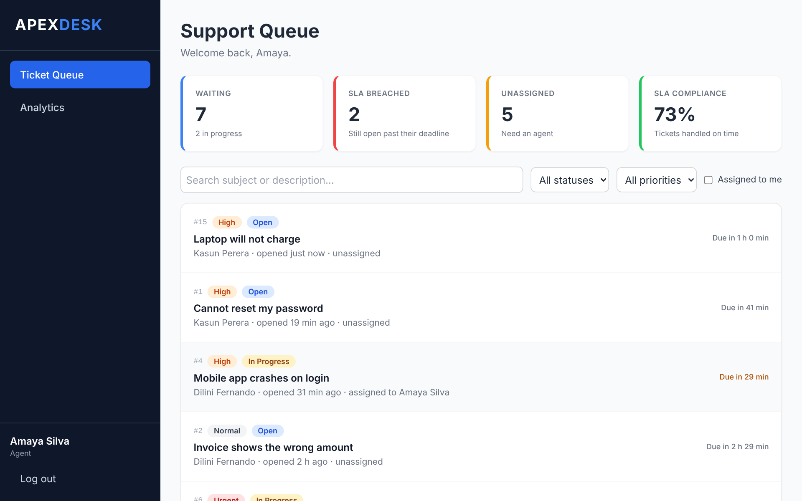
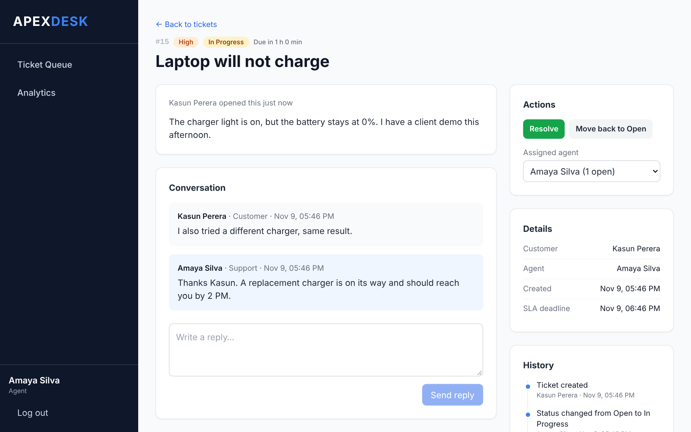
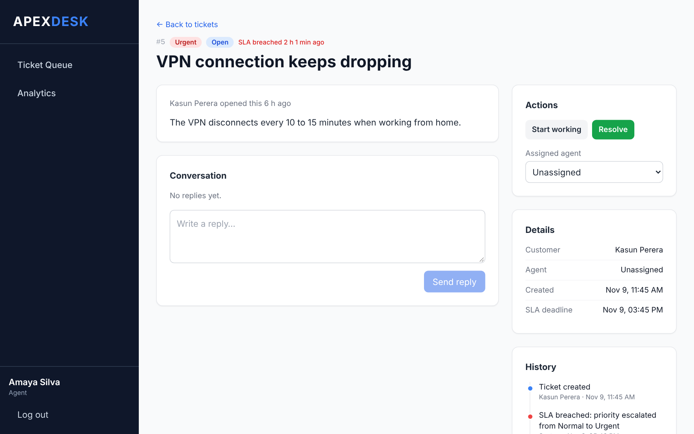
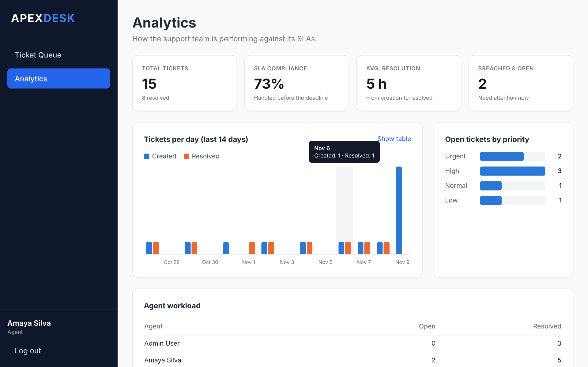
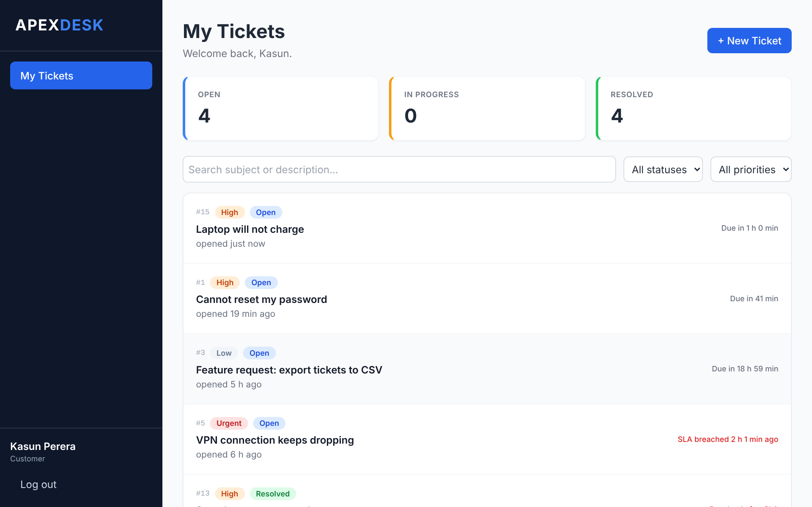
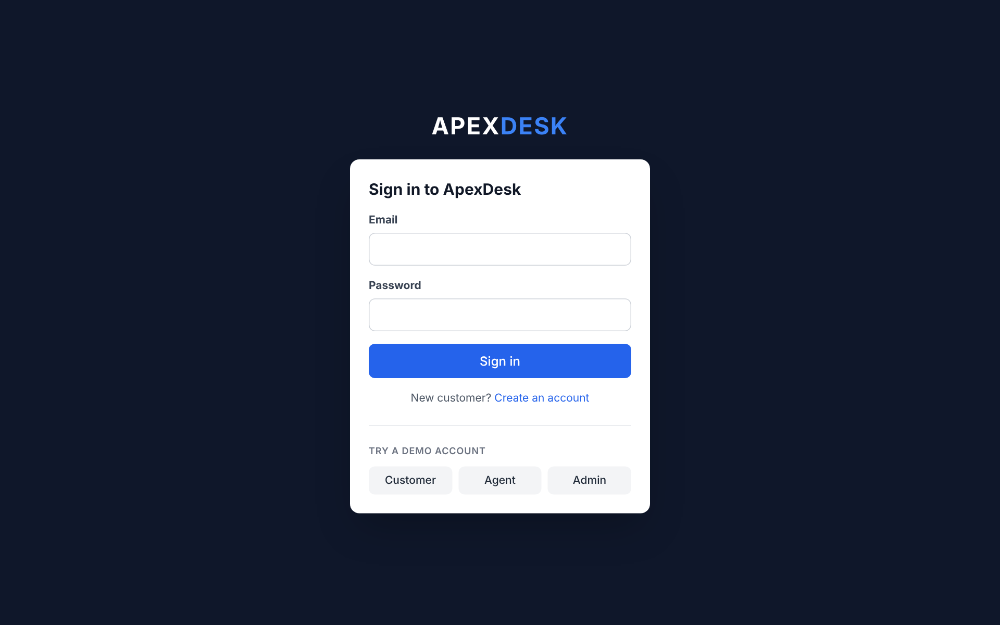
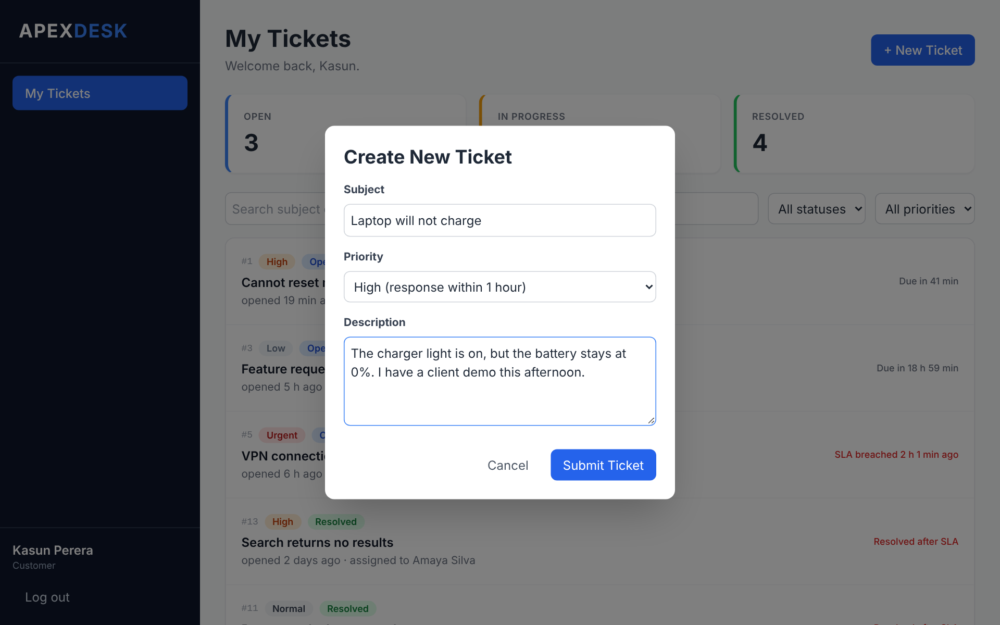
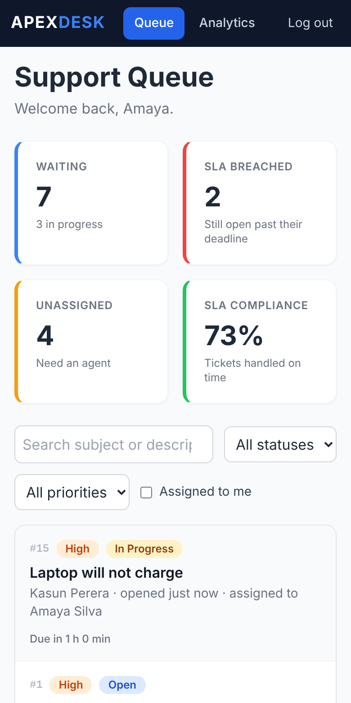
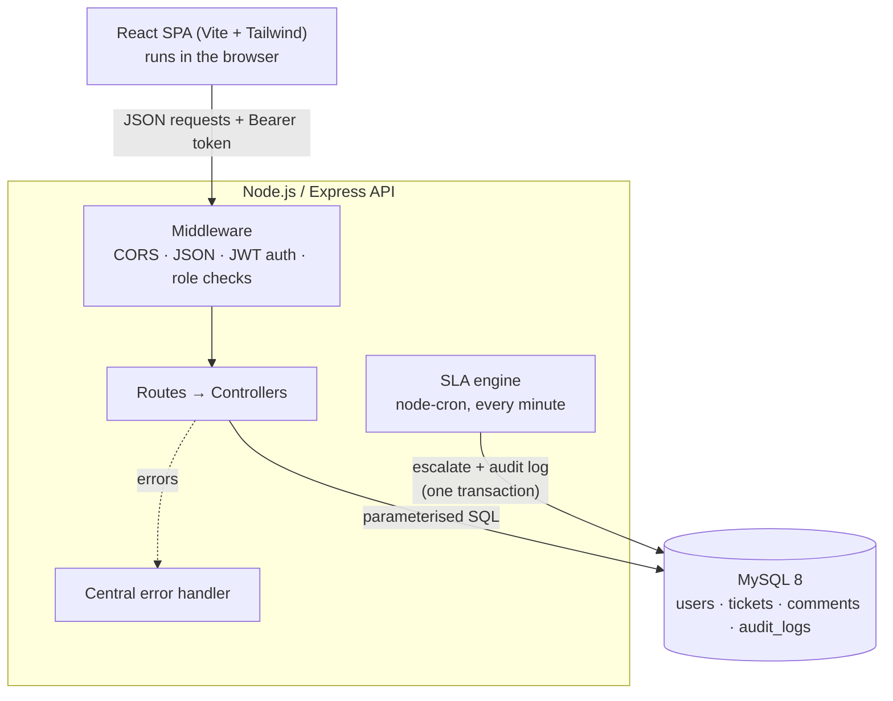

# ApexDesk: Support Ticketing with an Automated SLA Engine

[](https://github.com/inusha-anujith/enterprise-ticketing-system/actions/workflows/ci.yml)


A full-stack help desk where customers raise support tickets and agents work through them. Every ticket gets a deadline based on its priority, and a background job escalates tickets that miss their deadline, recording each change in an audit log.



## Features

**For customers**
- Sign up and log in (passwords hashed with bcrypt, sessions with JWT)
- Open tickets with a priority, follow their status and SLA deadline, and reply to the support team
- See only their own tickets. The API enforces this, not just the UI.

**For agents and admins**
- A shared queue with search, status and priority filters, and an "assigned to me" view
- Move tickets through `Open → In Progress → Resolved` (and reopen), with invalid moves rejected
- Assign tickets to agents and reply to customers
- A full history of every change on each ticket, including actions taken by the system
- An analytics page with SLA compliance, average resolution time, daily volume and agent workload
- Admins can create agent accounts

**The SLA engine**
- Each priority has a response window, configured in `.env` (defaults: Urgent 30 min, High 1 h, Normal 4 h, Low 24 h)
- A `node-cron` job runs every minute and finds unresolved tickets past their deadline
- Each one is marked as breached, escalated to **Urgent**, and logged as a **System** action, all inside one database transaction

## Screenshots

| Ticket conversation and history | SLA breach, escalated by the system |
|---|---|
|  |  |

| Analytics | Customer view |
|---|---|
|  |  |

<details>
<summary>More screenshots: login, new ticket, mobile</summary>

| Login with demo accounts | New ticket | Mobile |
|---|---|---|
|  |  |  |

</details>

## Architecture



**Request flow:** the React app sends a request with `Authorization: Bearer <token>`. The `authenticate` middleware verifies the JWT and attaches the user. `authorize(...)` checks the role. The controller runs parameterised queries through a MySQL connection pool. Any error thrown anywhere ends up in one error handler, which returns clean JSON and never leaks SQL details.

### Database

| Table | Purpose |
|---|---|
| `users` | Customers, agents and admins (`role` enum, bcrypt `password_hash`) |
| `tickets` | Subject, status, priority, `sla_due_at`, `sla_breached`, assigned agent, `resolved_at` |
| `comments` | The conversation on each ticket |
| `audit_logs` | Every change to a ticket. `performed_by_user_id` is `NULL` when the system made the change. |

Foreign keys keep the data consistent, and an index on `(status, sla_due_at)` keeps the SLA engine's query fast. The full schema is in [`database/schema.sql`](database/schema.sql).

## Tech stack

| Layer | Technologies |
|---|---|
| Frontend | React 19, React Router 7, Tailwind CSS 3, Vite |
| Backend | Node.js 22, Express 5, mysql2 (promise pool), node-cron |
| Auth | bcryptjs, jsonwebtoken |
| Testing | Jest, Supertest (40 integration tests against a real MySQL database) |
| CI | GitHub Actions: backend tests against a MySQL 8 service container, frontend lint and build |

## Getting started

**Prerequisites:** Node.js 22 and MySQL 8.

```bash
# 1. Clone and install
git clone https://github.com/inusha-anujith/enterprise-ticketing-system.git
cd enterprise-ticketing-system
npm install
cd frontend && npm install && cd ..

# 2. Configure: copy the example and fill in your MySQL password and a JWT secret
cp .env.example .env
node -e "console.log(require('crypto').randomBytes(32).toString('hex'))"   # paste into JWT_SECRET

# 3. Create the tables and demo data
npm run db:reset

# 4. Run the API (port 3000)
npm run dev

# 5. In a second terminal, run the frontend (port 5173)
cd frontend && npm run dev
```

Open http://localhost:5173 and use one of the demo accounts:

| Role | Email | Password |
|---|---|---|
| Customer | `customer@apexdesk.dev` | `Password123` |
| Agent | `agent@apexdesk.dev` | `Password123` |
| Admin | `admin@apexdesk.dev` | `Password123` |

The demo data includes two tickets that are already past their deadline, so you can watch the SLA engine escalate them within a minute of starting the API.

### Running the tests

```bash
npm test
```

The tests use a separate `apexdesk_test` database, which is rebuilt and reseeded before each test file, so your demo data is never touched.

## API reference

All endpoints except register, login and health require `Authorization: Bearer <token>`.

| Method | Endpoint | Access | Description |
|---|---|---|---|
| `GET` | `/api/health` | Public | API and database status |
| `POST` | `/api/auth/register` | Public | Create a customer account and return a token |
| `POST` | `/api/auth/login` | Public | Return a token for valid credentials |
| `GET` | `/api/auth/me` | Any user | The logged-in user |
| `GET` | `/api/tickets` | Any user | List tickets (customers only get their own). Query: `status`, `priority`, `search`, `mine=true` |
| `POST` | `/api/tickets` | Customer | Create a ticket: `{ subject, description, priority }` |
| `GET` | `/api/tickets/:id` | Owner or staff | Ticket with comments and full history |
| `PATCH` | `/api/tickets/:id/status` | Staff | `{ status }`, only allowed transitions |
| `PATCH` | `/api/tickets/:id/assign` | Staff | `{ agentId }`, or `null` to unassign |
| `POST` | `/api/tickets/:id/comments` | Owner or staff | `{ body }` |
| `GET` | `/api/tickets/stats` | Staff | Totals, SLA compliance, daily volume, agent workload |
| `GET` | `/api/users/agents` | Staff | Agents with their open-ticket counts |
| `POST` | `/api/users` | Admin | Create an agent or admin account |

Errors always come back as `{ "error": "message" }` with a meaningful status code: `400` validation, `401` not logged in, `403` wrong role, `404` not found (also used for other customers' tickets, so their existence isn't revealed), `409` duplicate email.

## Project structure

```
├── app.js                  # Express app: middleware + routes (imported by tests)
├── server.js               # Entry point: DB check, HTTP server, SLA engine
├── config/                 # Settings from .env, MySQL connection pool
├── controllers/            # Request handlers (auth, users, tickets)
├── middleware/             # JWT auth, role checks, error handler
├── routes/                 # URL → controller mapping
├── services/slaService.js  # SLA deadlines and the escalation job
├── utils/                  # Validation helpers, HttpError
├── database/               # schema.sql, setup and seed scripts
├── tests/                  # Jest + Supertest integration tests
├── .github/workflows/      # CI pipeline
└── frontend/
    └── src/
        ├── api/            # fetch wrapper (base URL, token, errors)
        ├── context/        # Auth context: logged-in user, login, logout
        ├── components/     # Layout, sidebar, badges, protected routes
        └── pages/          # Login, Register, Dashboard, TicketDetail, Analytics
```

## Design decisions

- **The API is the security boundary.** The frontend hides pages by role for convenience, but every endpoint checks the token and role itself. The customer on a new ticket comes from the token, never from the request body.
- **Everything is stored in UTC.** Each database connection is set to UTC, and the browser converts to local time for display. This fixed a real bug where a MySQL server set to local time (UTC+5:30) made new tickets look 5.5 hours in the future.
- **The SLA job is a plain function.** `runSlaCheck()` holds the logic, and `node-cron` only schedules it, so the tests can call it directly. It uses a transaction with `SELECT … FOR UPDATE`, so a ticket can't be escalated twice even if two server instances run.
- **Statistics are computed in SQL** (`COUNT`, `SUM(condition)`, `GROUP BY`) rather than by loading every ticket into Node.
- **No ORM.** Plain parameterised SQL keeps the queries visible and prevents SQL injection.

## Possible improvements

- Email notifications when a ticket is assigned, answered or breaches its SLA
- Refresh tokens or httpOnly cookies instead of storing the JWT in `localStorage`
- Pagination for the ticket list
- File attachments on tickets
